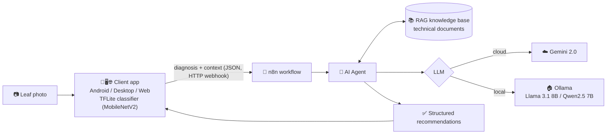

<div align="center">

# 🍅 Local LLM over n8n for Tomato Leaf Disease Analysis on Raspberry Pi 5

### Edge AI for precision agriculture: image classification + RAG + local Large Language Models, orchestrated with low-code n8n

-C51A4A?logo=raspberrypi&logoColor=white)


</div>

---

## 🌱 Why this project matters

Farmers in rural areas often have **limited connectivity, limited budget and no easy access to agronomic expertise**. Cloud AI assistants are powerful, but they depend on the internet, on recurring API costs and on sending field data to third parties.

This repository contains the **full implementation behind our research paper**, which asks a practical question:

> **Can a low-cost Raspberry Pi 5 run an agricultural assistant that diagnoses tomato leaf diseases and generates contextual recommendations, and what does it cost in latency, resources and reliability?**

What makes it relevant:

- 📡 **Edge-first design:** orchestration and LLM inference can run on a low-cost single-board computer. Embeddings for the RAG step still use a cloud service; a fully offline workflow is proposed as future work.
- 🔒 **Data stays close to the farm:** leaf images are classified on the client device and, in the local scenario, the answer is generated on your own hardware.
- 🔀 **Hybrid by design:** the same workflow runs with a **cloud model (Gemini)** or **local models (Llama 3.1 8B, Qwen2.5 7B via Ollama)**, so the trade-offs can be measured side by side.
- 🧩 **Low-code and reproducible:** the system is an **n8n workflow** that you can import, inspect and modify without writing a backend.
- 📱🖥️🌐 **Three real clients:** Android, desktop (Python) and web (Flask) all talk to the same service.
- 📊 **Honest benchmarks:** latency, RAM, CPU, temperature and failure rates measured on a PC and on a Raspberry Pi 5.

---

## 🏗️ System architecture



1. The client classifies the tomato leaf locally with a **quantized TFLite model** (early blight, late blight or healthy).
2. It sends the result to an **n8n webhook**, which assembles the request.
3. An **AI Agent** retrieves context from a **RAG knowledge base** built from technical documents.
4. The answer is generated by **Gemini (cloud)** or by **Llama 3.1 8B / Qwen2.5 7B (local, through Ollama)**.
5. The structured recommendation returns to the client.

---

## 📂 Repository contents

| | Folder | What it contains |
|---|---|---|
| 📱 | [`app_android`](./app_android) | **Android client** app. Classifies a tomato leaf image with the TFLite model and queries the n8n service. |
| 🖥️ | [`app_Desktop_tflite_clasifi`](./app_Desktop_tflite_clasifi) | **Desktop client** (Python script) with the TFLite classifier; sends requests to the n8n service. |
| 🌐 | [`app_web_tflite_clasifi`](./app_web_tflite_clasifi) | **Web client** built with **Flask**; runs the classifier and queries the n8n service from the browser. |
| 📸 | [`imagenes_rpi`](./imagenes_rpi) | **Execution evidence** on the Raspberry Pi 5 (workflow runs, logs, resource monitor). |
| 🧠 | [`modelos`](./modelos) | **Trained classifiers**: Keras models and their **quantized TensorFlow Lite** versions used by the clients. |
| 🔀 | [`n8n`](./n8n) | **Workflow exports (JSON)**, see below. |
| 🧪 | [`scripts_teachable`](./scripts_teachable) | Classification program exported from **Teachable Machine**, used for quick testing of the classifier. |

### 🔀 n8n workflows

| File | Target | Description |
|---|---|---|
| `ProyectoFinal_6junio_PC.json` | 💻 PC | Complete workflow (webhook → AI Agent → RAG → LLM) used for the PC experiments. |
| `ProyectoFinal_6junio_rpi5.json` | 🍓 Raspberry Pi 5 | Same workflow adapted to run on the Raspberry Pi 5. |
| `1pruebas_ollama.json` | 🧪 Test | Minimal workflow to check the connection between n8n and Ollama. |

---

## 🧰 Experimental setup

| | PC | Raspberry Pi 5 |
|---|---|---|
| **Hardware** | Intel Core i5-14400F, NVIDIA RTX 4060 | Raspberry Pi 5, 16 GB RAM, aluminum heat sink with active fan |
| **Software** | n8n + Ollama | n8n (Docker) + Ollama, Raspberry Pi OS 64-bit (Bookworm) |
| **Models** | Gemini 2.0 · Llama 3.1 8B · Qwen2.5 7B (4-bit GGUF) | Gemini 2.0 · Llama 3.1 8B · Qwen2.5 7B (4-bit GGUF) |
| **Clients** | Desktop · Web · Android | Desktop · Web · Android |

Each configuration was tested with 100 valid requests per client and platform (300 per model and platform).

---

## 📊 Key results (Raspberry Pi 5)

| Model | Type | Avg. latency per request | Success rate | Avg. RAM | Avg. max. temp. |
|---|---|---|---|---|---|
| **Gemini 2.0** | ☁️ Cloud | **12.9 – 13.8 s** | **99.0 %** (297/300) | ~0.79 GB | ~48 °C |
| **Llama 3.1 8B** | 🏠 Local | 655 – 730 s | 93.3 % (280/300) | ~7.62 GB | ~85 °C |
| **Qwen2.5 7B** | 🏠 Local | 865 – 945 s | 90.0 % (270/300) | ~6.88 GB | ~82 °C |

**Main findings**

- ⚡ On a PC, the three models answer in about **2.6 to 3.3 s**; on the Raspberry Pi 5, the local 7–8B models need **11 to 16 minutes** per request.
- 🧊 The cloud model keeps the Raspberry Pi cool and light, but **moving the n8n workflow from PC to Raspberry Pi 5 increases Gemini latency 4.9×** (2.62 s → 12.90 s): orchestration on the device is not negligible.
- 🔥 With CPU-only inference, the local models saturate the CPU (96–98 %) and **exceed the 80 °C throttling threshold**, so a 7–8B model is **feasible but not practical for interactive use** on this hardware.
- 🔬 Smaller or more aggressively optimized models, and fully offline workflows, are the natural next step.

> The numbers above summarize the paper. See the article for the complete tables, methodology, failure taxonomy and limitations.

---

## 🚀 Quick start

> File names inside each client folder may vary; adapt the commands to your copy.

### 1) Run the services (n8n + Ollama)

```bash
# Local LLMs
ollama pull llama3.1:8b
ollama pull qwen2.5:7b
```

Run n8n with Docker (official image `docker.n8n.io/n8nio/n8n`), open the editor in your browser (`http://localhost:5678`), then:

1. **Workflows → Import from file** and select the JSON from [`n8n`](./n8n) that matches your machine (PC or Raspberry Pi 5).
2. Configure your own **credentials** (e.g., Google Gemini API key for the cloud model and for embeddings) and the **Ollama** base URL.
3. Load your documents into the RAG knowledge base and **activate** the workflow.

### 2) Run a client

```bash
# Desktop client
cd app_Desktop_tflite_clasifi
pip install -r requirements.txt     # if provided
python <script_name>.py

# Web client (Flask)
cd app_web_tflite_clasifi
pip install -r requirements.txt     # if provided
python <app_name>.py                # then open http://localhost:5000
```

For the **Android client**, open [`app_android`](./app_android) in Android Studio and set the webhook URL of your n8n instance (use the machine's LAN IP, not `localhost`).

> 🔐 **Security:** never commit API keys or tokens. Configure credentials in n8n and keep any secret out of the JSON files and the client source code.

---

## 🔭 Scope and limitations

- Only **response latency, resource usage, temperature and reliability** were evaluated. The **quality of the generated answers was not formally evaluated** (content was only reviewed against the technical documents).
- Only **7–8B models with 4-bit quantization** were tested on the Raspberry Pi 5. Smaller models (1B–3B) are proposed as future work.
- RAM and CPU were measured with different tools per platform (`psutil` on PC, `top` on Raspberry Pi 5).
- Energy per query, cold/warm runs, tokens per second and statistical tests are future work.

---

## 📝 Citation

The article is currently **under review**. Please cite it as follows once published (details to be updated):

```bibtex
@article{yauri2026localllm,
  title   = {Local Large Language Model over n8n for Contextual Analysis of Tomato Leaf Diseases in Raspberry Pi},
  author  = {Yauri, Ricardo and Castro, Antero and Chicchon, Miguel},
  journal = {IEEE Latin America Transactions},
  year    = {2026},
  note    = {Under review}
}
```

## 👥 Authors

**Ricardo Yauri** · **Antero Castro** · **Miguel Chicchon**
Universidad Tecnológica del Perú (UTP), Lima, Peru

## 📄 License

Add the license of your choice (for example MIT for the code) in a `LICENSE` file at the root of the repository.

---

<div align="center">

⭐ If this project is useful to you, consider giving the repository a star.

</div>
